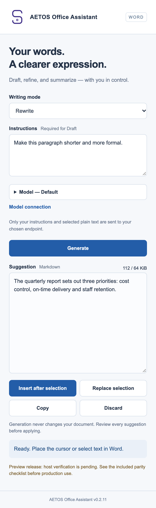
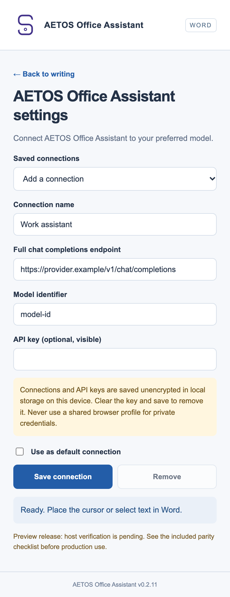

# AETOS Office Assistant

[](https://github.com/zzambia/aetos-office-assistant/actions/workflows/ci.yml)
[](https://github.com/zzambia/aetos-office-assistant/releases)

AETOS Office Assistant is a writing assistant that lives inside **Microsoft Word**, in the task pane beside your document. You give it an instruction, it proposes a draft, a rewrite or a summary, and **you decide whether to apply it**. Nothing is inserted into your document until you review the suggestion and click a button.

It works with the model of your choice. You connect your own endpoint and model identifier — there is no AETOS account, no subscription and no server in the middle.

## Screenshots

<table>
<tr>
<td width="50%" align="center"><br><sub><b>Task pane</b> — choose a mode, give instructions, review the suggestion, then insert or replace.</sub></td>
<td width="50%" align="center"><br><sub><b>Model connection</b> — save your own endpoint, model identifier and optional API key.</sub></td>
</tr>
</table>

These images are captures of the built task pane with sample content, not output from a live model, and the status line shows the text Word displays. Host verification in real Word is still pending; see [docs/PARITY.md](docs/PARITY.md) and [docs/HOST-TESTS.md](docs/HOST-TESTS.md).

## What does it do?

Pick one of three modes:

- **Draft** — place the cursor where the text should go and describe what you want written.
- **Rewrite** — select existing text and ask for a different tone, length or clarity.
- **Summarize** — select text and get a shorter version.

Every result appears in a preview first. You can edit it, then choose **Insert after selection**, **Replace selection**, **Copy** or **Discard**. Applying a change is a normal Word edit, so Word's own **Undo** works.

## Which model can I connect?

Any provider that offers an **OpenAI-compatible chat completions endpoint** and allows requests from a browser. That includes most hosted providers and local tools such as Ollama, LM Studio or llama.cpp's OpenAI-compatible server.

There is no preselected provider or model. You save:

- a connection name of your choice,
- the full endpoint URL (ending in `/chat/completions`),
- the exact model identifier,
- optionally a Bearer API key.

You can save up to 32 connections and mark one as default. The model only ever receives your instruction and the selected plain text — no full document, no images, no history.

Details, requirements and privacy notes: **[docs/MODELS.md](docs/MODELS.md)**.

## How do I install it?

Both installers run a small local HTTPS server on your own machine and register the add-in with Word. Neither sends your documents anywhere. Both are currently **unsigned preview builds**, so your operating system will ask for confirmation before running them.

**Windows**

1. Download `AETOS-Office-Assistant-<version>.exe` from the [latest release](https://github.com/zzambia/aetos-office-assistant/releases).
2. Run it and click **Set up AETOS Office Assistant**. Approve the certificate prompt if Windows asks.
3. Restart Word, then open **Add-ins → My Add-ins** and choose **AETOS Office Assistant**.

**macOS**

1. Download `AETOS-Office-Assistant-<version>-macos.zip` from the [latest release](https://github.com/zzambia/aetos-office-assistant/releases).
2. Unzip it and move **AETOS Office Assistant.app** to Applications.
3. Right-click the app and choose **Open** (macOS blocks unsigned apps on a normal double-click).
4. Follow the first-launch prompts, then restart Word and open the add-in from **Insert → Add-ins**.

Full steps, certificate notes and troubleshooting: **[docs/INSTALL.md](docs/INSTALL.md)**.

## Quick start (from source)

Requires Node.js 22 or later. There are **no npm dependencies** to install.

```sh
npm test            # 56 automated tests
npm run build       # builds dist/
```

Then either build a launcher for your platform, or run the add-in locally:

```sh
./macos/build.sh                      # macOS .app + zip
```

```powershell
powershell -ExecutionPolicy Bypass -File desktop/build.ps1   # Windows .exe
```

```sh
npm run mac:setup   # macOS: build, trust a localhost certificate, sideload into Word
npm start           # serve dist/ on https://localhost:3000
npm run mac:doctor  # check readiness
```

Building, hosting and CI details: **[docs/DEVELOPMENT.md](docs/DEVELOPMENT.md)**.

## Project status

Version 0.2.11 is an **implementation preview**. It is not a declaration of verified feature parity with the original WordCraft plugin, and the add-in has **not been fully verified inside a real Word installation**. 56 automated tests pass.

Target hosts are current Microsoft 365 Word on Windows (WebView2), current Microsoft 365 Word on macOS, and current Word for the web in a modern browser. The exact minimum tested Word build is **not yet established**. See [docs/ARCHITECTURE.md](docs/ARCHITECTURE.md) for the host policy.

Please read [docs/PARITY.md](docs/PARITY.md) and [docs/HOST-TESTS.md](docs/HOST-TESTS.md) before using this preview on important documents.

## Documentation

| Document | Contents |
|---|---|
| [docs/INSTALL.md](docs/INSTALL.md) | Installing on Windows and macOS, certificates, sideloading, troubleshooting |
| [docs/MODELS.md](docs/MODELS.md) | Connecting a model, endpoint requirements, key storage, what is transmitted |
| [docs/ARCHITECTURE.md](docs/ARCHITECTURE.md) | How it is built, integrity checks, limits, supported-host policy |
| [docs/DEVELOPMENT.md](docs/DEVELOPMENT.md) | Building, running locally, hosting `dist/`, CI and signing |
| [docs/PARITY.md](docs/PARITY.md) | Feature parity checklist against WordCraft |
| [docs/HOST-TESTS.md](docs/HOST-TESTS.md) | Manual host-test checklist and results |
| [docs/MAC.md](docs/MAC.md) | macOS-specific setup, ports and limits |
| [docs/CI.md](docs/CI.md) | Build pipeline, release process and code signing |
| [desktop/START_HERE.txt](desktop/START_HERE.txt) | End-user notes for the Windows launcher |

## Privacy and licence

The add-in has no analytics, no telemetry and no backend. Model credentials are stored unencrypted in the browser's local storage on your machine and are never written into Word documents. Office.js is loaded from Microsoft's official CDN at runtime.

No WordCraft code or Microsoft visual assets are included. The logo was supplied by the user from https://www.aetos-ai.it/images/aetos_logo_short.svg and is bundled locally; `desktop/render-logo.ps1` produces the raster sizes without changing the artwork.
